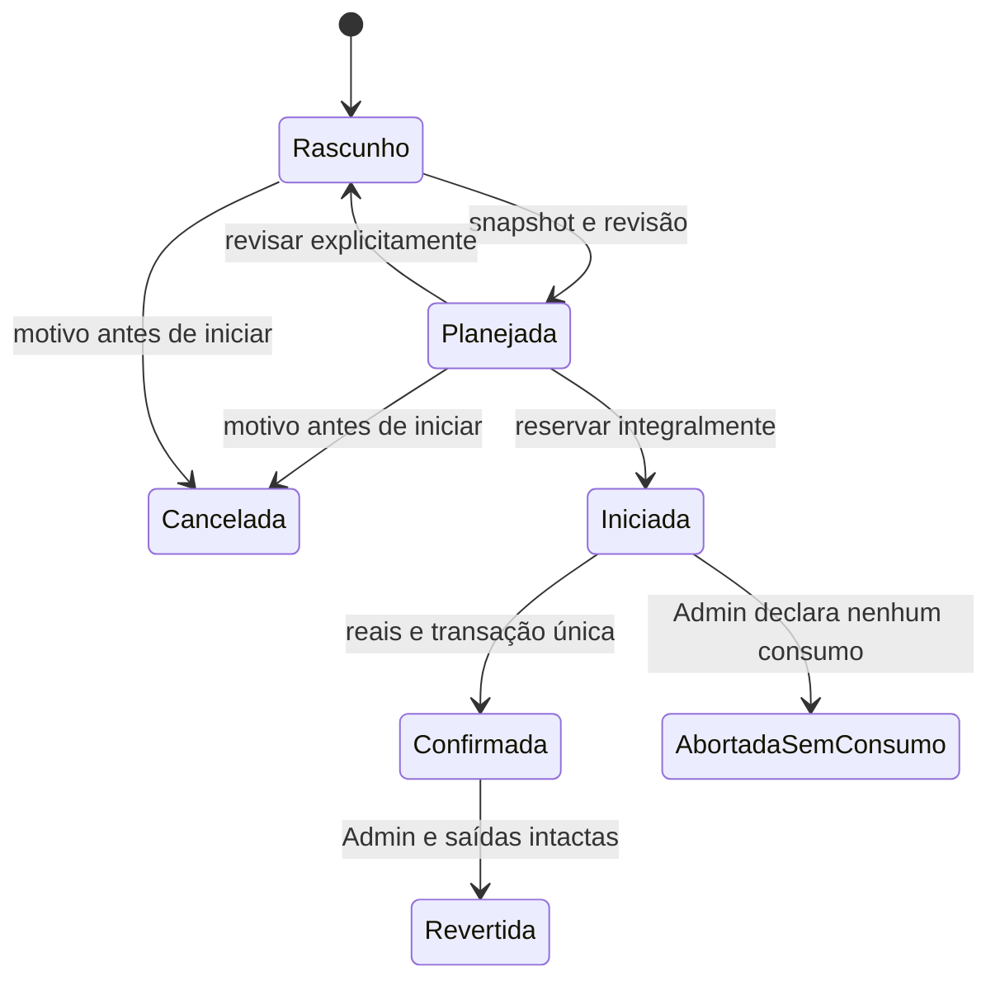

# F02 — adendo de ordens e execução física (P2.0 / #487)

Data: 24/10/2026. [Tarefa #487](https://devops-lab.tailaf9418.ts.net/issues/487), filha da [Evolução #430](https://devops-lab.tailaf9418.ts.net/issues/430), relacionada a #467/#434/#484. Baseline investigada: `425306167764c94519a843deaeb19505844e9114` de `origin/main`.

**Proposta para aceite humano; nenhuma regra nova deste adendo está aprovada.** A autorização recebida é executar P2.0 investigativa/documental. F01 está funcionalmente aceita (#438); isso não aprova F02. Nenhuma implementação, migration, tabela física, execução da aplicação ou alteração de banco foi feita nesta etapa. O [plano](../plans/2026-10-24-f02-ordens-execucao-487-implementation.md), a [evidência](../../validation/2026-10-24-p2-0-contrato-f02-487.md) e a [P2.1 condicionada](../plans/2026-10-24-p2-1-implementacao-f02-487-prompt.md) completam a proposta.

Este adendo detalha §9/D05/D06 da [especificação original](2026-10-05-producao-insumos-produtos-413-design.md) e §5/F02 do [plano original](../plans/2026-10-05-producao-insumos-produtos-413-implementation.md). Em conflito com desenho prospectivo, o comportamento F01 aceito é a referência existente; qualquer extensão abaixo depende de aceite.

## 1. Decisões materiais pendentes

Todos os IDs abaixo aguardam resposta explícita do responsável. Aceitar o documento, autorizar implementação, aceitar funcionalmente e autorizar merge são atos separados. Silêncio não aprova nenhuma opção.

| ID | Recomendação a aceitar | Alternativa real | Consequência operacional | Exemplo sintético |
| --- | --- | --- | --- | --- |
| D05 | Planejar sem reservar; iniciar reserva; confirmar todos os reais atomicamente, sem WIP/baixa parcial | Fase posterior com eventos de consumo por etapa e estoque em processo | Enquanto transforma, o físico contábil continua intacto e o material aparece reservado | Físico 100 kg, reserva 60: disponível 40; após confirmação de 58 consumidos: físico 42, reserva 0 |
| O01 | Admin aborta somente com declaração de nenhum consumo; havendo consumo, registrar reais/perda; saída zero exige Admin e motivo | Modelar execução parcial/WIP antes de operar processos longos | Interrupção não apaga material consumido; não há cancelamento que restaure saldo fictício | 20 kg consumidos, saída 0, perda total 20: baixa 20, sem lote fictício |
| R01 | Reversão compensatória por Admin somente de lançamento confirmado incorreto, com todos os lotes de saída intactos na origem e sem uso posterior; comprovar coerência física | Ajuste presente vinculado, ou futura devolução/reprocessamento com contrato próprio | Qualquer transferência/consumo/reserva posterior bloqueia reversão, mesmo se devolvida/liberada depois | B transferido e devolvido: reverter A→B retorna 409; anotar/ajustar situação atual |
| D06 | Autenticados leem/criam/planejam/iniciam/confirmam rotina; Admin aborta, confirma exceções e reverte; matriz §5 | Restringir também iniciar/confirmar a Admin, ou criar futuro papel de Produção | Mantém operação diária coerente com F01, mas amplia os efeitos de uma conta comum | Operador confirma 60→58+2; somente Admin confirma perda total |
| E01 | Mudança de status/validade preserva reserva e bloqueia rotina; Admin registra fato já ocorrido, distinguindo consumo apto de irregular, com saídas Bloqueadas em Segregacao | Rever modelo/WIP antes de operar processos sujeitos a esses casos | Registro do fato irregular não autoriza novo uso; evita reserva sem resolução e conserva responsabilidade/evidência | Lote vence durante processo: Admin distingue consumo elegível ontem de uso irregular hoje; ambos preservam o fato e a ocorrência |
| Q02 | Reusar Q01 F01: seis casas, resíduo aceito por linha, `un` inteira; receita publicada fixa planejamento e reais preservam desvios explícitos | Exigir nova versão publicada para qualquer desvio real | Não normalizar divergência nem supor equivalência nutricional; saída com perda usa Processamento | Planejado 100→98+2; real 99→96+3, ambos preservados |

**Prioridade definida pelo responsável em 24/10/2026:** “Aceitar primeiro o piloto de gestão”, em resposta à pergunta de sequência apresentada na P2.0. Portanto, fechar os pendentes P0/P1 e obter o aceite real do piloto precede a implementação F02. Essa escolha não é aceite dos fluxos atuais, do contrato F02 ou autorização de implementação. Transformação física continua evolução posterior, sujeita a repriorização explícita e aos próprios gates; entrada explícita de ovos exige F03.

## 2. Fronteiras e dados congelados

F02 usa `Item`, `LocalEstoque`, `LoteMaterial`, `PosicaoEstoque`, eventos/livro e projeção F01. Não duplica catálogo nem usa Propriedade como depósito/ACL. `PropriedadeId` opcional indica contexto operacional, com ID/rótulo histórico; não cria local, saldo, autorização ou transferência implícita. O local de cada entrada e saída é obrigatório e independente desse vínculo.

Ao planejar, escolher `ReceitaVersaoId` publicada e cabeçalho ativo. Guardar snapshot imutável com ID/número/revisão e conteúdo da versão, rótulos dos itens, linhas/IDs, unidades, escala fixa/variável, tamanho solicitado, quantidades planejadas, perdas/rendimentos esperados, etapas e referências exatas de perfis/conversões/subversão/saída. Percentuais e limites de escala seguem o domínio atual; não substituir pela versão mais recente. Editar planejada cria nova revisão e exige novo planejamento; iniciada não muda receita/plano.

Ao iniciar, alocar explicitamente quantidade por linha/item/lote/local; várias posições podem atender uma linha. Cada entrada tem um `linhaId` único e `alocacoes[]` com IDs próprios; rejeitar alocação duplicada para a mesma linha/lote/local, sem confundir linha com posição. Validar Item ativo, Local ativo/Ordinario, Lote ativo/Liberado, validade não vencida e unidades compatíveis. Sem FIFO/FEFO automático. Reserva integral de todas as entradas, inclusive embalagem/consumível; não iniciar uma fração. Receitas/perfis inativados depois do plano ficam consultáveis e impedem iniciar novo uso. Depois de iniciado, preservar snapshots; inativação documental da receita/perfil não invalida retroativamente a execução física. Status/validade dos materiais seguem E01.

Confirmar congela reais e desvios por linha, alocações, perdas justificadas, saídas/destinos, revisão, autor autenticado, responsável operacional ativo, horários UTC de planejamento/início/confirmação e ocorrência observada, data operacional e versão do algoritmo. Horário observado não reordena o livro nem permite backdating de saldos. Planejado e realizado são apresentados lado a lado.

Quantidade/fator atravessa API como string decimal invariante; backend `decimal` é autoridade. Unidade canônica de Item continua kg/L/un; g↔kg e mL↔L exatas. Outra dimensão exige conversão explícita do próprio item, versão/fator/fonte/contexto/amostra, inclusive se específica do lote. Sem fator, rejeitar movimento físico; não usar densidade típica. Aplicar quantização F01 e aceitar cada resíduo com motivo, preservando declarada/calculada/normalizada/resíduo; contagem fracionária continua recusada. Não recalcular a confirmação com conversão atual diferente do snapshot aprovado.

Saída positiva cria **novo lote** por parcela de saída/destino declarado; não misturar com lote existente. Rotina exige Item ativo/`PodeProduzir`, Local ativo/Ordinario, identificação única, origem na ordem, responsável e datas declaradas. Lote Bloqueado/vencido ou resultado irregular exige Local ativo/Segregacao, conforme F01; não creditá-lo como saída ordinária utilizável. Validade continua opcional conforme F01, com fonte/responsável se informada e aviso se ausente; não derivar prazo da receita, nem introduzir exigência por classe que F01 não implementa. Perfil/conversão da saída são escolhas explícitas, sem herança automática dos ancestrais. Saída zero é linha da execução, nunca lote/movimento de quantidade zero. Se Item/local de destino se tornou inelegível após início, E01 exige Admin e escolha explícita de destino de segregação ativo; não reativar cadastro silenciosamente.

Depois da criação, vedar recebimento ordinário adicional F01 no lote de origem Produção; novo recebimento usa novo lote. Transferência conserva o lote e não acrescenta origem. Ajuste presente Admin continua permitido com vínculo/motivo, mas a genealogia distingue correção positiva/negativa da quantidade efetivamente produzida e nunca atribui incremento à execução original. Todo movimento posterior também bloqueia R01. Essa extensão explícita de F01 precisa de teste/regressão e aceite no conjunto R01/Q02.

Sub-receita na simulação expande hipóteses; **na execução consome somente o intermediário em estoque**. Para fabricar intermediário, criar outra ordem e confirmá-la explicitamente. Sem orquestração de árvore nem débito dos ancestrais duas vezes. Grafo físico é LoteEntrada→Execução→LoteSaída, com quantidades e evento/linha ligados; multissaída preserva todos os insumos e saídas do processo, sem inventar percentual causal ou distribuição de nutrientes/custos. Histórico consulta para frente e para trás, com prevenção de ciclo e profundidade/paginação explícitas.

## 3. Estados, reservas e confirmação

Cancelada, AbortadaSemConsumo e Revertida são terminais, sem apagar snapshots/auditoria; tentativa de outra produção usa nova ordem. Ocorrência não é estado que libera saldo. Registrar desvio, falta, perda ou interrupção em histórico imutável com autor/data observada/motivo; interrupção mantém Iniciada e todas as reservas até resolução explícita. Sem expiração automática de reservas, timeout de processo ou liberação por logout.

Por posição: `fisico = soma assinada do livro`, `reservado = soma das alocações ativas`, `disponivel = fisico − reservado`, com `0 ≤ reservado ≤ fisico`. Exibir separadamente aptidão: vencido/bloqueado/inativo mantém físico/reserva, mas **disponível para uso ordinário = 0**, com motivo. Não exibir saldo matemático como material utilizável. Não somar kg/L/un. Reservas não são movimentos físicos e não entram no livro de F01.

Iniciar adquire locks, revalida todas as posições/revisões, cria reservas/histórico e muda estado em uma transação. Se uma linha for insuficiente, rollback de tudo; ordem continua Planejada. Duas ordens disputando 60 de 100 não podem ambas iniciar: uma reserva 60 e outra recebe 409, disponível final 40.

Confirmar recebe todas as entradas reais, perdas e saídas. Entrada real menor que reserva consome só o real e libera o restante. Cada reserva conserva `original = ativa + consumida + liberada`, sem reescrever quantidade original. Entrada maior ou troca explícita de lote/local exige disponibilidade adicional validada atomicamente na confirmação e alocação suplementar criada/consumida no mesmo commit; na posição substituída, liberar o original não utilizado. Mostrar diferença antes de enviar. Não trocar Item/receita nem criar nova linha silenciosamente: mudança material de receita exige nova versão/ordem; ajuste real de quantidade é desvio documentado. Se não houver saldo adicional, 409 preserva ordem Iniciada e reservas originais, sem consumo/saída parcial.

Uma transação única: verificar idempotência/revisão/estado/elegibilidade → validar reais e disponibilidade descontando reservas de outras ordens → debitar entradas → registrar perdas → criar lotes e créditos de saída → genealogia/snapshots/auditoria → consumir/liberar reservas → Confirmada → persistir resposta idempotente → commit. Aumentar débito nunca ultrapassa `fisico − reservasDeOutrasOrdens`. Toda retirada F01 (transferência, saída, consumo, ajuste para baixo, segregação e descarte) também respeita esse limite; Admin não pode furar reserva. Ajuste contado abaixo do reservado retorna 409 e exige resolução da execução, sem reparar saldo automaticamente.

**Perdas sem dupla baixa:** em A=100 kg→B=98 kg+perda=2 kg, o débito de A é 100, não 102. Perda de processo é destinação do material já consumido, não outro débito. Perda de insumo anterior à incorporação compõe o total retirado da posição e fica discriminada nessa linha. Não somar embalagem no rendimento alimentar. Balanço/rendimento somente com massas/conversões e escopo compatíveis; incompatível é indeterminado. Diferença não explicada exige observação explícita, sem inventar perda de ajuste; nutrientes não são recalculados por simples rendimento. `MisturaSimples` com perda/desvio de massa exige tratamento explícito como ocorrência de processamento no realizado, sem alterar a classificação/snapshot da receita nem presumir conservação nutricional.

Consequência D05: numa transformação longa que já retirou fisicamente material, o sistema ainda mostra físico contábil e reserva. A UI deve avisar isso na ordem e no estoque. Se essa representação não atender à operação, **não iniciar F02 assim**: reabrir contrato para WIP/consumo por etapa (eventos parciais, devoluções, medição do processo e compensações por etapa, com novas conciliações/estados/testes).

## 4. Ocorrências e reversão

Antes de iniciar, falta mantém Planejada e permite revisar/cancelar com motivo. Depois de iniciar, desvio/interrupção gera ocorrência; sem consumo físico, Admin pode declarar `nenhumConsumoFisico=true`, motivo e versão/chave e abortar, liberando reservas atomicamente. Declaração falsa não é validada automaticamente: responsabilização e evidência são humanas.

Havendo qualquer consumo, abortar/cancelar retorna 409. Informar todos os reais, inclusive entradas reservadas não usadas como zero e saldo liberado. Confirmação exige algum débito real positivo; zero consumo com zero saída deve abortar, e saída positiva sem consumo é inválida. Perda total/saída total zero exige Admin, justificativa e evidência; mantém Confirmada com resultado `PerdaTotal`. Não produz lote vazio. Desvios/perdas parciais justificados podem ser confirmados por autenticado; não criar tolerância quantitativa fictícia. Falta de estoque ou validade/status que mudou não elimina o fato físico: manter reserva e abrir ocorrência para resolução.

E01 propõe via excepcional Admin de registro de **fato já ocorrido**, com data observada, quantidades, status atual/no fato, evidência e responsável. Se comprovadamente apto no momento, documentar isso; se consumido após vencimento/bloqueio/inativação ou sem prova de aptidão, registrar `ConsumoIrregular`, sem afirmar regularidade ou autorizar novo uso. Essa via finaliza o fato físico atomicamente, debita somente o efetivamente ocorrido, registra ocorrência, libera reservas e bloqueia todas as saídas em Local Segregacao ativo; permite saída zero/perda total. Não relaxa saldo não negativo, revisão, identidade, quantização, autoria ou idempotência. Registrar irregularidade difere de um override para iniciar/consumir novo material: início e confirmação ordinária permanecem vedados. Sem saldo contábil ou evidência do ocorrido, suspender o comando e diagnosticar divergência com responsável; não fabricar estoque. Sem aceite E01, esse caso permanece bloqueante operacional antes de operar F02.

Reversão R01 é correção excepcional de registro incorreto, não transformação física inversa. Admin declara motivo, coerência com a contagem física, revisão esperada e chave. Dentro dos mesmos locks verificar **todos** os lotes de saída: quantidade original integral no local original, nenhuma reserva posterior (mesmo já liberada), movimento posterior de qualquer tipo, consumo, transferência, segregação, venda/vínculo comercial ou execução descendente; nenhum ajuste/uso posterior, mesmo se o saldo voltou ao original. Um único impeditivo retorna 409 e não toca nada. Mudança de status/validade da saída também bloqueia a reversão conservadora; fonte encerrada não é reaberta.

Fonte Encerrada retorna409 **antes de qualquer compensação**, sem tentar reabri-la nem debitar saídas primeiro. Se admissível, gravar eventos compensatórios: débito integral das saídas e crédito exato dos débitos originais nas posições de entrada, usando quantidade canônica **normalizada originalmente registrada**, sem reaplicar conversão/quantização atual. Declaração/resíduo/aceite originais continuam como evidência ligada ao movimento compensado; o novo fato de compensação identifica essa semântica nas guardas, sem fingir uma nova medição com o fator antigo. Vínculos aos eventos/execução, histórico e estado Revertida são atômicos. Não apagar ou editar livro, comando, genealogia ou lote; lotes gerados ficam com saldo zero e situação terminal. Restauração de entrada inativa/bloqueada/vencida é registro compensatório, não liberação para uso; mantém restrições e sinalização. Perda total não tem saídas a testar, mas exige a mesma evidência de erro/contagem das entradas; não recria material realmente perdido. Sem correspondência física, usar ajuste presente.

Quando saídas já usadas ou fato físico é irreversível: anotação imutável vinculada à execução e/ou ajuste presente F01 justificado com `ExecucaoReferenciaId` explícita. Ajuste não reverte estado da ordem, não percorre/restaura ancestrais nem reescreve saldos passados; continua sujeito a Admin, disponibilidade, contagem e livro F01. Qualquer referência comercial futura deve participar do bloqueio de reversão antes de sua implantação. Confirmar com o responsável se R01 é suficientemente restritiva para a rotina real.

## 5. D06: papéis exatos

Papéis da aplicação encontrados: sessão autenticada e `Admin`. O papel **Codex do Redmine** só governa rastreabilidade e não concede permissão ERP. Nenhum papel global será alterado. A matriz F02 inteira é proposta; as colunas F01 descrevem autorização existente, não nova autorização.

| Ação | Autenticado comum | Admin | Base |
| --- | --- | --- | --- |
| F01 consultar locais/lotes/posições/livro/histórico e prévias ordinárias | Sim | Sim | Atual |
| F01 criar Local ativo (inclusive Segregacao), criar Lote normal/Bloqueado e editar metadados; entrada, transferência ordinária, saída manual e consumo interno | Sim | Sim | Atual; identidade/status/validade/referências têm comandos próprios |
| F01 criar Local já inativo; criar Lote para Item inativo/sem PodeEntrar, obrigatoriamente Bloqueado | Não | Sim | Atual; permissão dinâmica preservada no replay |
| F01 consultar reconciliação e responsáveis | Sim | Sim | Atual; consulta não repara saldo |
| F01 abertura e ajuste contado | Não | Sim | Atual; guardas também no serviço |
| F01 status/finalidade de local; status/situação/validade/perfil/conversão de lote; segregação/retorno/descarte | Não | Sim | Atual |
| F02 consultar ordem/snapshot/disponibilidade/genealogia/histórico | Sim | Sim | Proposta D06 |
| F02 criar/editar rascunho; planejar/revisar; cancelar antes de iniciar | Sim | Sim | Proposta D06; versão/motivo |
| F02 iniciar/reservar e registrar ocorrência | Sim | Sim | Proposta D06 |
| F02 confirmar rotina e desvios/perdas parciais justificados | Sim | Sim | Proposta D06 |
| F02 confirmar perda total, fato passado E01; abortar sem consumo; reverter | Não | Sim | Proposta D06/O01/R01/E01 |
| F02 consultar reconciliação global de reservas e tratar ajuste presente | Não | Sim | Proposta D06, coerente com inventário F01 |

Anônimo recebe 401; autenticado sem permissão, 403 antes de leitura sensível/mutação. Autor vem do token; responsável selecionado não eleva permissão. Como F01, reconsultar usuário ativo/papel no servidor depois de obter lock e antes de replay, inclusive permissões dinâmicas: claim antiga não permite repetir comando privilegiado após perder Admin. Nenhuma fronteira por Propriedade ou regra “só dono” é introduzida implicitamente.

## 6. Concorrência, HTTP e idempotência

F01 atual já usa ReadCommitted e locks transacionais **catálogo `(413,421)` → inventário `(430,1)`**, timeout 5 s. Preservar essa ordem; acrescentar lock Produção `(430,2)` após ambos em comandos que cruzam produção/estoque, nunca adquirir catálogo após inventário. Não reutilizar lock Animal/Caixa; concorrência de escrita continua deliberadamente serializada no recorte. Lock próprio F02 não substitui lock F01. Não aninhar transações/repositórios que abram novo escopo.

Adquirir o conjunto completo de linhas com ordenação determinística: Ordem → Itens por ID → Locais por ID → Lotes por ID → Posições por (LoteId,LocalId) → Reservas por ID. Apoios Propriedade/responsável usam a convenção atual, sem ordem inversa. Caminhos F01 sem ordem mantêm Item→Local→Lote→Posição. Leituras de conciliação usam snapshot RepeatableRead somente leitura e corte de sequência F01/revisão de reservas para que uma leitura não misture instantes. Testar também interleavings com catálogo/F01; não prometer escalabilidade de locks por posição antes de medir.

Todo comando material exige `versaoEsperada`, `Idempotency-Key` não vazia até 100 caracteres e resultado transacional. Para confirmação/reversão/aborto, unicidade `(OrdemId,Operacao,Chave)`, não por autor: outro operador autorizado pode recuperar a mesma resposta sem gerar segundo fato; autor original permanece no snapshot. Hash canônico inclui payload de negócio, versão esperada, responsáveis, evidência de exceção, destinos e aceite de resíduos; normaliza apenas campos decimais tipados e alocações por ID, nunca textos/documentos numéricos nem ordem semântica de etapas. IDs de linha não repetem; ausência e nulo seguem DTO definido. Persistir status HTTP, Location, corpo e IDs no mesmo commit.

Após autorizar, procurar replay **antes** de revalidar revisão/estado/referências atuais: mesma ordem/operação/chave/hash retorna a resposta original, inclusive após inativação ou reversão posterior (estado atual em GET separado). Mesma chave/payload diferente: 409 `idempotencia_divergente`; outra chave tentando confirmar ordem já Confirmada/Revertida: 409 `estado_invalido`. Duplo clique/corrida com a mesma chave retorna uma execução. Timeout/queda após commit: repetir mesma chave/payload ou consultar comando; nunca gerar chave nova por falta de resposta. Falha antes do commit não persiste comando/fatos; retry completo é seguro. Chaves não são reutilizadas/expurgadas silenciosamente.

| HTTP | Critério proposto |
| --- | --- |
| 200 | Ação de estado bem-sucedida; replay conserva o status original |
| 201 | Criação de ordem, com Location; replay conserva o mesmo ID |
| 400 | Formato, unidade/quantidade, linha duplicada ou evidência obrigatória ausente |
| 401/403 | Sem sessão / ação vedada; sem efeito colateral |
| 404 | Ordem, receita, item, lote, local ou referência realmente inexistente |
| 409 | Versão/estado, referência existente inativa/incompatível, saldo/reserva insuficiente, lote inelegível, idempotência divergente, reversão impedida ou conflito transitório |

ProblemDetails conserva código estável e orientação acionável; timeout de lock/deadlock mapeado a conflito transitório sem sucesso parcial. Invariante persistida quebrada não é conflito cotidiano: erro operacional sanitizado, correlação e bloqueio do comando; reconciliar antes de liberar operação, sem expor SQL/credenciais. Nenhuma falha é convertida em saldo zero ou sucesso.

## 7. Reconciliação e recuperação

Reconciliação Admin confronta: soma assinada do livro = projeção física; soma de reservas ativas = reservado derivado; reservado por posição ≤ físico; apenas Iniciadas têm reserva; Confirmadas/Abortadas/Revertidas não têm reserva ativa; cada confirmação tem exatamente um conjunto de comandos/eventos/genealogia; compensação é única e integral. Reservas expostas são agregação derivada, sem segundo contador independente nesta proposta. Nunca atualizar saldos para fazer o relatório passar.

Falha injetada em qualquer ponto antes do commit deve deixar ordem/revisões/reservas/livro/projeção/lotes/genealogia/comando como antes. Após commit, replay recupera o mesmo resultado. Reserva antiga não é lixo: localizar ordem e responsável, conciliar, registrar ocorrência e obter declaração de consumo antes de liberar. Corrupção/divergência: preservar evidência e backup, suspender mutações afetadas, diagnosticar em cópia isolada; qualquer correção aditiva/ajuste presente precisa de autorização e vínculo auditável. Sem reparo automático, `Down` destrutivo ou edição direta do livro.

Fora de F02: custos F04, ponte de ovos F03, venda/fiscal/caixa, solver, WIP, consumo parcial, validade inferida, nutrientes presumidos e orquestração automática de ordens. Dados anteriores permanecem intactos; nada é derivado retroativamente.
